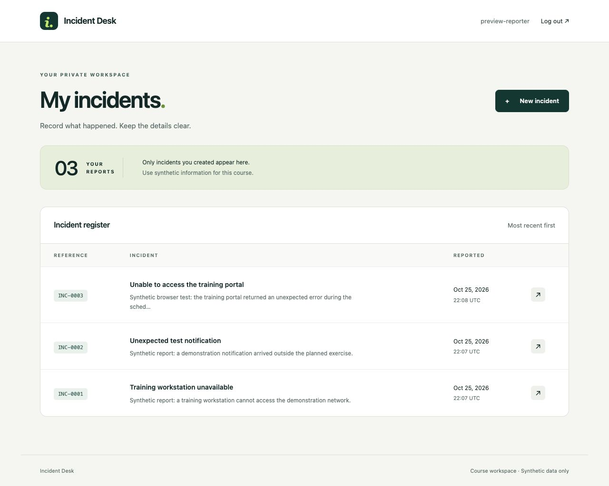

# Incident Desk — Django Course Starter

A small, working incident-management application for an application-security capstone. Start with a safe private reporting workflow, push it to your personal GitHub repository, deploy it, and add functionality and security automation over six weeks.

The supplied starter already provides login/logout, private incident creation/list/detail, administrator-managed accounts, migrations, synthetic local sample records, and security regression tests. This student copy extends it with severity/status, analyst assignment, plain-text comments and an audit trail. It still has no public registration, file uploads, or outbound email.



## What you need

- Python 3.12 or 3.13 (the course/CI target is 3.12).
- Git. Docker Desktop/Engine with Compose is the standard local PostgreSQL option.
- A personal GitHub account. Deployment also requires a personal Vercel Hobby account and an isolated hosted PostgreSQL database, for example a free Neon database.
- No frontend package manager or JavaScript build tool is required.

Work **inside this folder**: the one containing manage.py. If using the downloadable ZIP, extract it first. This repository should contain Incident Desk only, not the deliberately vulnerable course lab apps.

## 1. Create your Python environment

macOS/Linux:

```bash
python3 -m venv .venv
source .venv/bin/activate
python -m pip install -r requirements.txt
```

Windows PowerShell:

```powershell
py -3.12 -m venv .venv
.\.venv\Scripts\python.exe -m pip install -r requirements.txt
```

On Windows you may keep using `.\.venv\Scripts\python.exe` wherever this guide says `python`; activation is optional.

## 2. Configure local development

Copy .env.example to .env in your editor/file manager. Generate a private local key:

```bash
python -c "import secrets; print(secrets.token_urlsafe(50))"
```

Paste it into DJANGO_SECRET_KEY in .env. Keep the local settings module and database URL from the example. .env is ignored by Git. Do not put this key in a screenshot, report or GitHub commit. If omitted locally, a temporary key is generated and restarts invalidate sessions.

Start the database:

```bash
docker compose up -d --wait db
python manage.py migrate
python manage.py createsuperuser
python manage.py runserver 127.0.0.1:8000
```

If Docker is unavailable on your machine, use the loopback-only SQLite development settings instead of the PostgreSQL commands above:

```powershell
.\.venv\Scripts\python.exe manage.py migrate --settings=config.settings.local_sqlite
.\.venv\Scripts\python.exe manage.py createsuperuser --settings=config.settings.local_sqlite
.\.venv\Scripts\python.exe manage.py runserver 127.0.0.1:8000 --settings=config.settings.local_sqlite
```

This creates an ignored `incidentdesk-dev.sqlite3` file in the project. It is only for synthetic local data; `local_sqlite` refuses to load when the Vercel environment marker is present. Production still requires PostgreSQL and `config.settings.production`.

The database is exposed only on **127.0.0.1:55432**, to reduce clashes with existing PostgreSQL installations. Its fixed password is for local Docker development only, never a hosted database. If the port is occupied, change compose.yml and DATABASE_URL together; do not stop an unrelated service.

Open http://127.0.0.1:8000/admin/ and sign in with your newly created superuser. Under Users, add a normal reporter account with a unique password and leave Staff status/Superuser status unchecked. Log out, then use http://127.0.0.1:8000/accounts/login/ as that reporter.

The superuser is an administrative identity and can inspect records through Django admin; normal application views show only the signed-in user's own incidents, even if the user is staff. Administrative account management is a starting tool, not the future custom administrator role.

Optional local sample records (in another terminal with the same environment):

```bash
python manage.py seed_incidents --username YOUR_REPORTER_USERNAME
```

This command creates two synthetic records once, creates no accounts/passwords, and refuses production settings. Replace the username placeholder. Public deployments must not use shared demo passwords.

## 3. Try the workflow

1. Sign in as your reporter.
2. Create an incident with a title and description using synthetic information.
3. Open the report from the register.
4. Create a second normal user through admin; verify their register does not show the first reporter's incident.
5. Try the first report's URL as the second user: the expected result is 404.
6. Log out using the button, which submits a CSRF-protected POST.

Controls already present: Django authentication/password hashing, database sessions, session rotation on login, logout invalidation, CSRF middleware/form tokens, ORM queries, template autoescaping, server-selected ownership, owner-scoped queries, input limits, private-page no-store headers, and an application CSP.

### Application roles and incident workflow

Migration `0002` creates the Django groups **Incident Analysts** and **Incident Administrators**. A Django superuser can assign those groups in `/admin/`; ordinary application administrators do not need Django superuser access.

- Reporters see incidents they created and may add plain-text comments.
- Analysts see incidents they created or that are assigned to them. Only the assigned analyst can move a report through its allowed status transitions.
- Application administrators can see every report, assign/unassign incidents to active analyst accounts, and perform status transitions.
- Incident ownership, initial status, assignment and comment author are selected by the server. Audit events record creation, status changes, assignments and comments without copying comment contents, credentials, or request data into the audit log.

See [docs/ACCESS_POLICY.md](docs/ACCESS_POLICY.md) for the access matrix and transition rules. When creating the first analyst, add their account to **Incident Analysts**. Add a separate trusted account to **Incident Administrators** to manage assignments.

These are a foundation, not a production security certification. Login throttling, richer access policy, audit events and operational monitoring are student work. Do not use real incident/personal data in this course application.

## 4. Run tests

Fast, isolated tests (in-memory SQLite, no Docker needed):

```bash
python manage.py test --settings=config.settings.test
python manage.py makemigrations --check --dry-run --settings=config.settings.test
```

PostgreSQL integration tests (local database running):

```bash
python manage.py test --settings=config.settings.ci
```

PostgreSQL test credentials need permission to create/drop a disposable test database; the local course DB user has this. Never run tests against production. `test` and `ci` settings intentionally use fast MD5 hashes only to speed isolated tests; they must never be selected for a deployment. Local/production use Django's normal password hashers.

`.github/workflows/tests.yml` runs both standard test variants. `.github/workflows/security.yml` adds the SQL injection hardening gate, Semgrep, pip-audit and Gitleaks. These workflows are prepared locally; their GitHub Actions results remain pending until you push this project. Authenticated ZAP DAST is still a manual, isolated lab milestone.

## 5. Publish your code to GitHub

Use the instructor's GitHub template when available, or create an empty **personal** repository and follow [docs/GITHUB.md](docs/GITHUB.md). Review `git status` before the first commit. `.venv`, `.env`, database files and generated staticfiles must not be uploaded.

## 6. Deploy

Follow [docs/DEPLOYMENT.md](docs/DEPLOYMENT.md). The app is configured for Vercel's native Django detection, not a Docker deployment. Use hosted PostgreSQL; a local SQLite file cannot persist application writes on Vercel. Migrations and initial administrator creation are explicit operations; they never run on HTTP requests or automatically in the build.

## Project map

| Path | Purpose |
|---|---|
| config/settings/ | Local, production and isolated test settings |
| incidents/models.py | Incidents, comments and audit events |
| incidents/access.py | Reporter/analyst/application-admin object policy |
| incidents/forms.py | Explicit editable fields and validation |
| incidents/views.py | Private list/detail, workflow and server-owned actions |
| incidents/tests/ | Behavior, ownership, role policy, workflow, CSRF, sessions and deployment config tests |
| templates/ and static/ | Server-rendered pages and local CSS |
| docs/ | GitHub, deployment, teaching milestones, threat-model scaffold and validation |

For the SQLite setup, stop the local server with **Ctrl+C** in its terminal. If using the optional Docker/PostgreSQL setup, `docker compose stop` stops services and `docker compose up -d --wait db` restarts the database. `docker compose down` removes containers while retaining the database volume. **`docker compose down -v` deletes this project's database**, including accounts and reports: use it only for an intentional reset.

For the first course session on native Windows PostgreSQL, follow the French step-by-step guide in [docs/PREMIERE_SEANCE.md](docs/PREMIERE_SEANCE.md). The local SQLite module remains a fallback; it does not satisfy the PostgreSQL connection exercise.

## Optional deliberate-flaw challenge

The [SQL injection challenge](exercises/sql-injection/README.md) runs only under isolated local `security_lab` settings with a disposable synthetic SQLite database. It is absent from normal app routes and forbidden on Vercel. In this working copy, the vulnerable query is repaired and all five hardening tests pass. The supplied starter archive remains unchanged; the instructor keeps the solution guide and an independent test copy for assessment.
